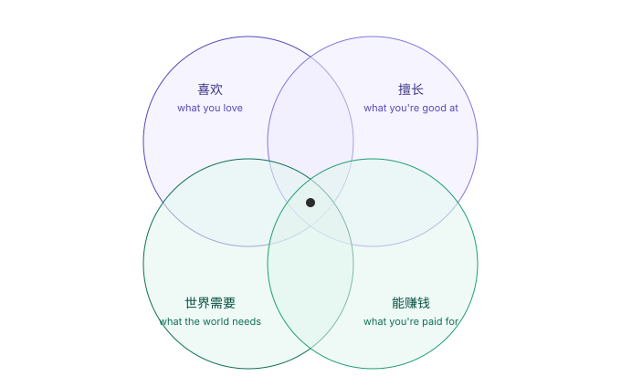

# 找自己 · Find Your Ikigai

用 **AI 追问**帮你找到自己的 Ikigai（人生目的 / 底层驱动力）。你不填任何表、不做任何测试，**只需要回答 AI 的提问**。

AI 沿四个维度（喜欢 / 擅长 / 世界需要 / 能赚钱）追问，每个维度聊透后回述确认、落盘存档，最后输出一份**带你自己原话**的 Ikigai 框架。



## 为什么不是「填表」或「问你的爱好是什么」

- **「你的爱好是什么」问得太泛**，答案往往是「打游戏、看电影」——那是消遣，不是驱动力。
- **填表你会卡住**：不知道怎么填，或者填的是「别人期望的答案」。

所以这里换成 **AI 问、你答**：AI 负责把散的回答挖深、归纳，你只需要想到什么说什么。

## 安装

任意支持 skill 的工具都能用（Claude Code / WorkBuddy / Codex / Cursor…）。

```bash
# 自动安装（默认装到 WorkBuddy）
./install.sh

# 或指定目标目录
./install.sh ~/.claude/skills      # Claude Code
./install.sh ~/.workbuddy/skills   # WorkBuddy
```

手动安装也很简单：把 `SKILL.md` 复制到下面任意一个目录下的 `find-your-ikigai/` 文件夹里。

| 工具 | 技能目录 |
|---|---|
| Claude Code | `~/.claude/skills/` |
| WorkBuddy | `~/.workbuddy/skills/` |
| Codex | `~/.codex/skills/` |
| 项目级（各工具通用） | `<你的项目>/.claude/skills/` 或 `<你的项目>/.workbuddy/skills/` |

装好后直接说一句：**「找自己」**。

## 一次对话长什么样

- **8–12 轮问答，30–45 分钟。** 不用一次性答完，中途关掉也能接着来（有落盘）。
- 每轮 AI 只问一个问题，一次只聊一个维度。
- 每个维度聊完，AI 会用一句话回述你的答案请你纠正——**不准就当场改**，别让它把你的答案理解歪了。
- 确认后 AI 会写一份 `我的Ikigai-YYYYMMDD.md`，你可以随时打开看到进度。

## 输出

```
你的 Ikigai
├── 喜欢：……
├── 擅长：……
├── 世界需要：……
├── 能赚钱：……
└── 交集（你该去做的事）：……
```

除了框架，还会给你三样东西：

1. **原话证据**——每一格的结论下面附你自己说过的话，防止 AI 用漂亮话糊过去。
2. **gap**——哪一格是空的，以及这个空是「没能力」还是「没机会」。
3. **一个两周内能做完、能被别人看见的具体动作**，不是一句「加油」。

样例见 [`examples/sample-dialogue.md`](examples/sample-dialogue.md)。

## 关于 Ikigai

Ikigai 是日语词，意思是「人生的理由」。它是四个维度的交集：

| 维度 | 问的是什么 |
|---|---|
| **喜欢** | 做什么会让你忘记时间 |
| **擅长** | 什么你做得比别人快、比别人好 |
| **世界需要** | 什么让你看不下去、特别想解决 |
| **能赚钱** | 别人愿意为你的什么付费 |

四者的交集，就是你该去做的那件事。

参考：[Ikigai（维基百科）](https://zh.wikipedia.org/wiki/生き甲斐)

---

## v2 改了什么

v1 是一个很好的提问脚本，但真跑一遍会发现几个问题。v2 针对性地改了 6 处：

| # | v1 的问题 | v2 的改动 |
|---|---|---|
| 1 | 全程靠上下文记忆，关窗即丢失 | **每个维度确认后立刻落盘**，增量更新，用户能看到进度 |
| 2 | 最后一次性输出，用户只能点头 | **每个维度回述确认**，邀请用户纠正；没确认的维度不进最终框架 |
| 3 | 「世界需要」对半径小的人直接失灵 | 加**降半径兜底**：答不出就从「家人/身边人的小事」切入 |
| 4 | 说了要「来自用户原话」，但没要求记录 | 硬性要求每维度留 2 条原话，输出时附在结论下 |
| 5 | 「下一步」只有一句鼓励 | 改为**可交付、有期限、能被看见**的动作 + 用户不敢开口时的拆解方案 |
| 6 | 目录名 `find-your-ikigai` 与 name `找自己` 不一致，跨工具装会踩坑 | `name` 统一为 `find-your-ikigai`，中文名放 `display_name` |

另外补充了两处实战经验：

- **小说/剧集不等于消遣。** 要区分「追着情节走」（叙事驱动）和「脑子里在整理结构」（结构驱动），两者导向完全不同的 Ikigai。
- **矛盾不要替他圆。** 用户自称「不爱计划」却提前半个月排行程——这种矛盾往往是整个对话最有价值的地方。

---

## 来源与许可

本仓库 fork 自 [carlxien-blip/find-your-ikigai](https://github.com/carlxien-blip/find-your-ikigai)，原作者 [Carl](https://kaerai.club)（卡尔 AI 俱乐部）。

原仓库**未声明 LICENSE**。在没有明确许可证的情况下，默认保留所有权利，因此：

- 本仓库仅作为 **fork / 向原仓库提 PR** 的用途存在，不主张独立版权。
- 如果你要单独分发改进版，请先取得原作者授权，或等原作者补充 LICENSE。
- 欢迎把 v2 的改动以 PR 形式提回上游。

## 致谢

提问框架、四维度设计、「消遣挖成驱动力」「AI 追问替代填表」的核心思路，来自 Carl 的原版。
